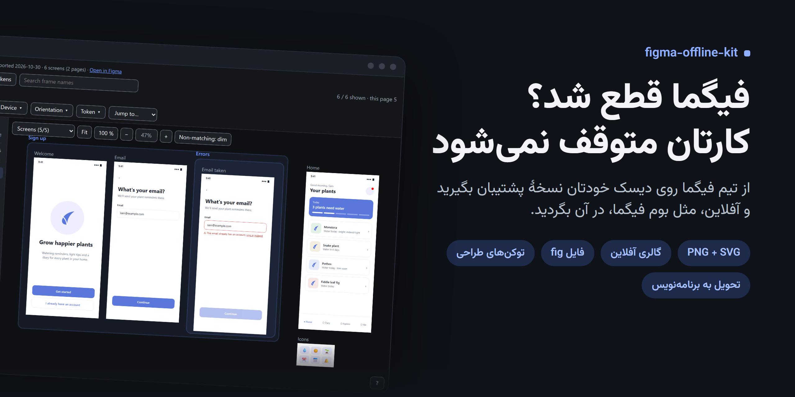
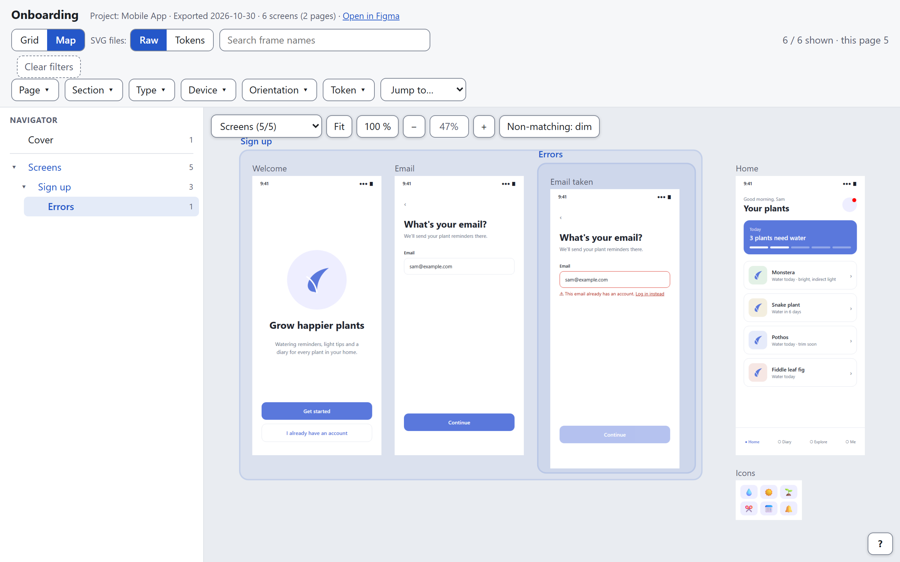
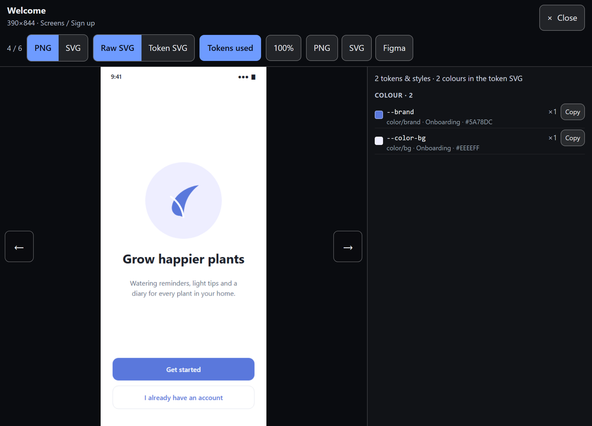
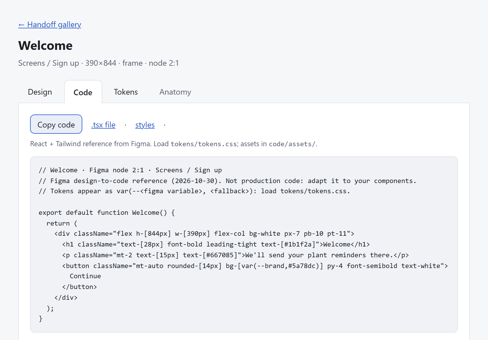
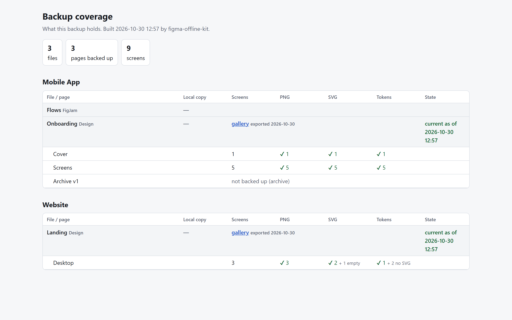

<p align="center">
  <a href="README.md">English</a> · <b>فارسی</b>
</p>

<p align="center">
  
</p>

<h1 align="center">figma-offline-kit</h1>

<div dir="rtl">

<p align="center">
  از تیم فیگمای خود روی دیسک خودتان نسخهٔ پشتیبان بگیرید، تا وقتی فیگما یا اینترنت قطع است، کارتان متوقف نشود.<br>
  <sub>رایگان · متن‌باز · در فیگما فقط می‌خواند · با هر دستیار هوش مصنوعی یا بدون آن</sub>
</p>

</div>

<p align="center">
  <a href="https://github.com/aenimaa/figma-offline-kit/releases/latest"></a>
  
  
  <a href="LICENSE"></a>
</p>

<div dir="rtl">
<p align="center"><sub>ویندوز · مک · لینوکس · <a href="https://aenimaa.github.io/figma-offline-kit/">نمونهٔ زنده را ببینید</a> (اپ ساختگی)</sub></p>
</div>

---

<div dir="rtl">

## 🚀 شروع در یک دقیقه

**🤖 با دستیار هوش مصنوعی:** این پوشه را در Claude، Gemini، Copilot، Cursor یا هر برنامهٔ هوش مصنوعی دیگری باز کنید و بنویسید: **«از تیم فیگمای من نسخهٔ پشتیبان بگیر.»** دستیار فایل [`AGENTS.md`](AGENTS.md) را می‌خواند، چند سؤال را در یک پیام می‌پرسد و بقیهٔ کار را انجام می‌دهد. اگر به فارسی بنویسید، فارسی جواب می‌دهد.

**⌨️ بدون هوش مصنوعی:**

</div>

```
python kit.py doctor      # چه چیزی آماده است
python kit.py init        # چند سؤال
python kit.py plan        # چه مقدار و در چه مدت
python kit.py pages       # انتخاب صفحه‌ها
python kit.py run         # در پس‌زمینه اجرا می‌شود
python kit.py close       # وارسی و بستن آرشیو
```

<div dir="rtl">

فقط **پایتون ۳٫۱۰ یا جدیدتر** و یک **[توکن فیگما](docs/figma-token.md)** با دسترسی خواندن لازم است. کیت بقیه را خودش بررسی می‌کند و می‌گوید چه چیزی کم است.

## 📦 چه چیزی تحویل می‌گیرید

### 🗺️ گالری آفلاین برای هر فایل

همهٔ فریم‌ها به‌صورت **PNG و SVG**، در پوشه‌هایی به ترتیب پروژه، فایل، صفحه و سکشن. مثل بوم فیگما در آن‌ها بگردید: نقشه‌ای از جای هر فریم، درخت صفحه‌ها، فیلتر، جست‌وجو و نمایشگر تمام‌صفحه. از روی دیسک باز می‌شود و اینترنت لازم ندارد.

</div>

<picture>
  <source media="(prefers-color-scheme: dark)" srcset="docs/images/gallery-map-dark.png">
  
</picture>

<div dir="rtl">

### 🎨 توکن‌های طراحی کنار هر صفحه

متغیرهای شما به‌صورت `tokens.css` و `_tokens.scss`. برای هر صفحه، توکن‌ها و استایل‌هایی که استفاده کرده و رنگ‌هایی که به هیچ توکنی وصل نیستند. SVGهای توکنی همان تصویرند، با رنگ‌هایی که به‌شکل `var(--token, #hex)` نوشته شده‌اند. [بیشتر](docs/tokens.md)

</div>



<div dir="rtl">

### 🧩 بستهٔ تحویل به برنامه‌نویس

برای صفحه‌هایی که برنامه‌نویس لازم دارد: برای هر فریم یک صفحه با **طراحی · کد · توکن‌ها · آناتومی**، خروجی design-to-code خود فیگما و مشخصات کامپوننت‌ها. [بیشتر](docs/handoff.md)

</div>



<div dir="rtl">

### ✅ گزارشی از آنچه دارید

صفحهٔ `COVERAGE.html` همهٔ پروژه‌ها، فایل‌ها و صفحه‌ها را نشان می‌دهد: چه چیزی پشتیبان شده، چه چیزی و چرا کنار مانده، و کدام فایل‌ها از آن به بعد در فیگما عوض شده‌اند. هر پروژه هم در یک آرشیو آزموده بسته می‌شود.

</div>



<div dir="rtl">

### 💾 و خود فایل‌ها

نسخه‌های محلی **`.fig`، `.jam` و `.deck`** از فیگمای دسکتاپ؛ یا هوش مصنوعیِ دارای کنترل دسکتاپ آن‌ها را ذخیره می‌کند، یا خودتان دکمهٔ Save را می‌زنید. با فاصلهٔ کافی، تا بررسی ضدربات فیگما فعال نشود. [بیشتر](docs/local-copies.md)

## ⚙️ چطور کار می‌کند

| | قدم | چه اتفاقی می‌افتد |
|---|---|---|
| ۱ | **بررسی** | پایتون، اینترنت، توکن و ابزارها را بررسی می‌کند و می‌گوید چه چیزی آماده است و چه کاری باید بکنید |
| ۲ | **پرسش‌ها** | یک دور سؤال: لینک تیم یا فایل‌ها، محل ذخیره، نحوهٔ اجرا، صفحه‌ها و افزونه‌ها |
| ۳ | **برنامه** | فیگما را می‌گردد و تعداد صفحه‌ها، زمان و حجم را تخمین می‌زند |
| ۴ | **صفحه‌ها** | همهٔ صفحه‌ها با ✔ یا ✖؛ صفحه‌های آرشیو و جداکننده کنار می‌مانند، مگر اینکه خودتان بخواهید |
| ۵ | **اجرا** | در پس‌زمینه خروجی می‌گیرد، با بستن برنامه متوقف نمی‌شود، قطعی‌ها را صبر می‌کند و ادامه می‌دهد |
| ۶ | **پایان** | همه‌چیز را وارسی می‌کند، فایل‌های عوض‌شده را نشان می‌دهد، صفحهٔ پوشش را می‌سازد و آرشیوها را می‌بندد |

## 🔒 ایمن از ابتدا

- **در فیگما فقط می‌خواند.** هیچ‌وقت چیزی را در فیگما ویرایش، جابه‌جا، اشتراک‌گذاری یا حذف نمی‌کند.
- **توکن شما روی دیسک خودتان می‌ماند**، در `workstation/.env`، و هیچ‌وقت چاپ یا در گزارش و لاگ نوشته نمی‌شود.
- **با فیگما مؤدب است:** دست‌کم ۱٫۵ ثانیه بین درخواست‌ها، رعایت کامل محدودیت‌ها، و حدود ۴۰ نسخهٔ محلی در روز.
- **چیزی پاک نمی‌شود.** نسخهٔ قبلی فایل‌هایی که دوباره خروجی می‌گیرند به `temp/replaced/` منتقل می‌شود.

## 📚 راهنماها (انگلیسی)

[توکن فیگما](docs/figma-token.md) · [سرورهای MCP فیگما](docs/figma-mcp.md) · [نسخه‌های محلی](docs/local-copies.md) · [توکن‌های طراحی](docs/tokens.md) · [تحویل به برنامه‌نویس](docs/handoff.md) · [پرسش‌های رایج](docs/faq.md) · [رفع مشکل](docs/troubleshooting.md)

---

<p align="center"><sub>مجوز MIT · وایب‌کد شده توسط <a href="https://github.com/aenimaa">Nima Sh</a>، طراح محصولی که نمی‌خواست با قطعی اینترنت، کارش هم قطع شود</sub></p>

</div>
