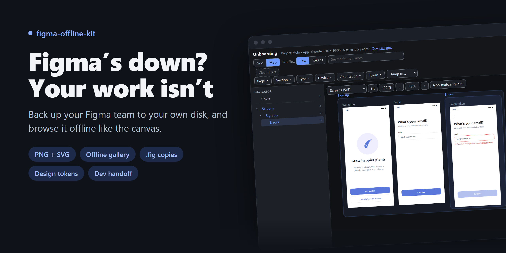

<p align="center">
  <b>English</b> · <a href="README.fa.md">فارسی</a>
</p>

<p align="center">
  
</p>

<h1 align="center">figma-offline-kit</h1>

<p align="center">
  Back up your Figma team to your own disk, and keep working when Figma or the internet is down.<br>
  <sub>Free · open source · read-only in Figma · works with any AI assistant, or on its own</sub>
</p>

<p align="center">
  <a href="https://github.com/aenimaa/figma-offline-kit/releases/latest"></a>
  
  
  <a href="LICENSE"></a><br>
  <sub>Windows · macOS · Linux · <a href="https://aenimaa.github.io/figma-offline-kit/">See the live demo</a> (made-up app)</sub>
</p>

---

## 🚀 Start in a minute

| 🤖 With an AI assistant | ⌨️ On your own |
|---|---|
| Open this folder in Claude, Gemini, Copilot, Cursor or any other AI app, and say:<br><br>**“Back up my Figma team.”**<br><br>It reads [`AGENTS.md`](AGENTS.md), asks a few questions in one message, and runs the rest. | `python kit.py doctor`: what's ready<br>`python kit.py init`: a few questions<br>`python kit.py plan`: how much, how long<br>`python kit.py pages`: choose pages<br>`python kit.py run`: runs in the background<br>`python kit.py close`: check and pack |

You need **Python 3.10+** and a read-only **[Figma token](docs/figma-token.md)**. The kit checks everything else and tells you what's missing.

## 📦 What you get

### 🗺️ An offline gallery for every file

Every frame as **PNG and SVG**, in folders by project, file, page and section. Browse them like the canvas: a map of where each frame sits, a page tree, filters, search, and a full-screen viewer. It opens from disk, no internet needed.

<picture>
  <source media="(prefers-color-scheme: dark)" srcset="docs/images/gallery-map-dark.png">
  
</picture>

### 🎨 Design tokens next to every screen

Your variables as `tokens.css` and `_tokens.scss`. For each screen, the tokens and styles it uses, and the colours bound to nothing. Token SVGs keep the picture and write colours as `var(--token, #hex)`. [More](docs/tokens.md)


### 🧩 A handoff package for developers

For the pages a developer needs: one page per frame with **Design · Code · Tokens · Anatomy**, Figma's own design-to-code output, and component specs. [More](docs/handoff.md)


### ✅ Proof of what you have

`COVERAGE.html` shows every project, file and page: what's backed up, what's left out and why, and which files changed in Figma since. Each project is packed into a tested archive.


### 💾 And the real files

Local **`.fig` / `.jam` / `.deck`** copies from Figma desktop, saved for you by an AI with desktop control, or with you pressing Save. Paced so Figma's bot checks don't kick in. [More](docs/local-copies.md)

## ⚙️ How it works

| | Step | What happens |
|---|---|---|
| 1 | **Doctor** | checks Python, network, token and tools; lists what's ready and what you need to do |
| 2 | **Questions** | one round: a team link or file links, where to save, how to run, which pages and extras |
| 3 | **Plan** | scans Figma and estimates screens, time and size |
| 4 | **Pages** | every page with ✔ or ✖; archive and divider pages are left out until you say otherwise |
| 5 | **Run** | exports in the background, survives closing the app, waits out outages, resumes |
| 6 | **Close** | verifies everything, flags files changed in Figma, writes the coverage page, packs archives |

<details>
<summary><b>📁 What ends up on your disk</b></summary>

```
<workspace>/
├─ backup/            the deliverable
│  ├─ COVERAGE.html   what the backup holds
│  ├─ <project>.zip   one tested archive per project
│  └─ <project>/<file>/
│     ├─ index.html   the offline gallery
│     ├─ <file>.fig   local copy (Figma → Import to restore)
│     ├─ screens/png · svg · pdf · svg-tokens/<page>/[<section>/]NNN <frame> [<id>].<ext>
│     └─ variables/   tokens.css · _tokens.scss · variables.figma.json
├─ handoff/<name>/    dev handoff packages
├─ temp/              scratch, safe to delete
└─ workstation/       REPORT.md (progress) · settings · logs · .env (your token)
```

If a browser won't open `file://` pages, serve the folder: `python -m http.server --directory "<workspace>/backup"`.
</details>

## 🔒 Safe by design

- **Read-only in Figma.** It never edits, moves, shares or deletes anything there.
- **Your token stays on your disk**, in `workstation/.env`. It's never printed, logged or put in a report.
- **Polite to Figma:** at least 1.5 s between calls, rate limits honoured in full, about 40 local copies a day.
- **Nothing is deleted.** Refreshed files move to `temp/replaced/`.

## 📚 Docs

[Figma token](docs/figma-token.md) · [Figma MCP servers](docs/figma-mcp.md) · [Local copies](docs/local-copies.md) · [Design tokens](docs/tokens.md) · [Dev handoff](docs/handoff.md) · [FAQ](docs/faq.md) · [Troubleshooting](docs/troubleshooting.md) · [Changelog](CHANGELOG.md)

---

<p align="center"><sub>MIT license · Vibe-coded by <a href="https://github.com/aenimaa">Nima Sh</a>, a product designer who didn’t want an outage to stop his work</sub></p>
